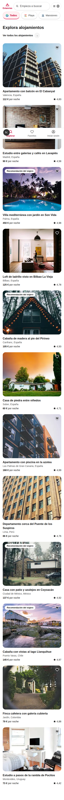
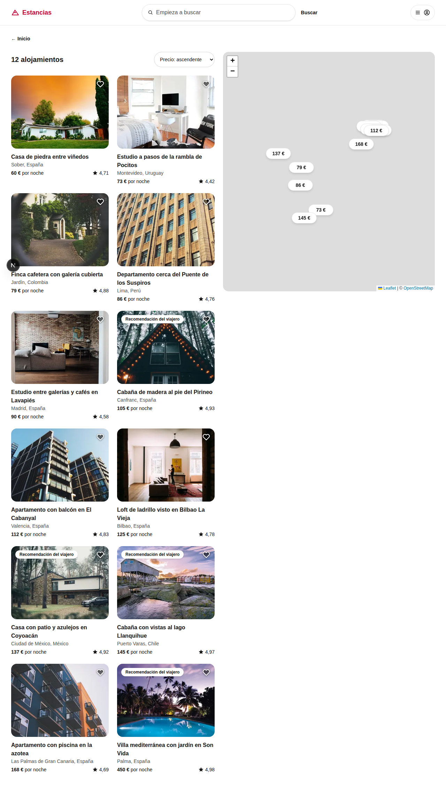
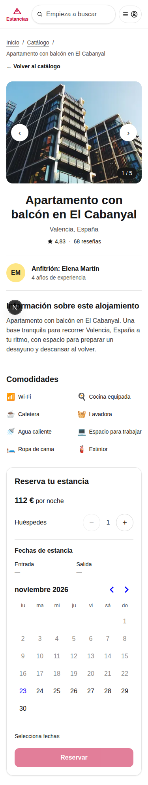

# Estancias — clon de la interfaz de Airbnb

Clon de la interfaz de Airbnb con **Next.js 16**, **React 19**, **TypeScript estricto** y **Tailwind CSS**. Tiene tres vistas (Home, Catálogo y Detalle) con datos ficticios, diseño *mobile-first* y los dos retos opcionales: un mapa interactivo con Leaflet y un selector de fechas que calcula el total.

| Home (375 px) | Catálogo (1280 px) | Detalle (375 px) |
| --- | --- | --- |
|  |  |  |

## Stack

- Next.js 16 (App Router) y React 19
- TypeScript en modo estricto
- Tailwind CSS 4: todos los estilos son clases de utilidad, sin `style={{}}` ni librerías de componentes
- `leaflet` + `react-leaflet` (reto del mapa) y `react-day-picker` + `date-fns` (reto de fechas)

## Cómo ejecutarlo

```bash
npm install && npm run dev
```

Abre <http://localhost:3000>. Otros comandos:

```bash
npm run lint    # ESLint
npm run build   # build de producción
npm start       # sirve el build
```

## Rutas

| Ruta | Qué muestra |
| --- | --- |
| `/` | Home: navbar con buscador, filtros por categoría y cuadrícula de alojamientos (1 columna en móvil, varias en escritorio). Carga simulada de 1 s con spinner. |
| `/catalog` | Catálogo: recuento de resultados, orden por precio ascendente/descendente y mapa Leaflet con un pin de precio por alojamiento (debajo de la lista en móvil, fijo a la derecha en escritorio). Acepta `?q=` para buscar. |
| `/rooms/[id]` | Detalle: galería cíclica, cabecera con valoración, anfitrión, servicios y tarjeta de reserva con huéspedes, fechas y total. Carga simulada de 1 s. Un id inexistente (p. ej. `/rooms/999`) devuelve 404 con enlace al Catálogo. `/rooms/1` es un alias del primer alojamiento. |

## Estructura de carpetas

```text
app/                    Rutas (App Router)
├─ page.tsx             /
├─ catalog/page.tsx     /catalog
└─ rooms/[id]/          /rooms/[id] (page, layout y not-found)
components/             29 componentes, uno por archivo, todos ≤ 67 líneas
mocks/                  Datos ficticios: alojamientos, fichas y categorías
public/photos/          20 fotos locales (licencias en docs/CREDITS.md)
types/listing.ts        Listing, Room (extiende Listing), Host y Category
docs/                   Registros del proyecto y capturas
context.md              Usuario, páginas, componentes y especificaciones de visión
```

## Decisiones de diseño

- **Mobile-first:** las clases base están pensadas para 375 px y `md:` (≥ 768 px) solo adapta el diseño a escritorio. Se comprobó que no hay scroll horizontal a 375 px en ninguna ruta.
- **Estado local y derivado:** la Home guarda la lista original y deriva los resultados de la búsqueda y la categoría en cada render, así que no se pierden datos al filtrar. El Catálogo ordena una copia. El total de la reserva se calcula a partir de las fechas, no se guarda en el estado.
- **Carga simulada:** `useEffect` + `setTimeout` de 1 s, con limpieza del temporizador, en Home y Detalle. Ambas muestran un indicador con `role="status"`.
- **Navegación:** todos los enlaces internos usan `Link` de `next/link`, así que la navegación es del lado del cliente y no recarga la página.
- **Fotos:** archivos locales en /public/photos, licencias en docs/CREDITS.md; si una foto falta, se muestra el placeholder. Son 20 fotos CC0 servidas con `next/image` (`ListingPhoto`); el placeholder es un gradiente con el icono del tipo de alojamiento (`PlaceholderPhoto`) y también aparece si la imagen falla al cargar. No se enlaza a servidores externos.
- **Leaflet solo en cliente:** el mapa se carga con `next/dynamic` y `ssr: false`, y muestra el placeholder gris «Mapa» mientras tanto.
- **Accesibilidad:** nombres accesibles en los botones de icono, `aria-pressed` en las categorías, áreas táctiles de 44 px como mínimo y textos de la interfaz en español.
- **Especificación antes del código:** cada vista se especificó a partir de capturas de Airbnb con un prompt de visión antes de implementarla (ver `context.md`, sección 6).

## Retos opcionales hechos

- **Mapa interactivo (4.4):** `react-leaflet` con teselas de Esri World Street Map (sin clave de API; ver ERR-019), un pin de precio por alojamiento según sus coordenadas, encuadre automático y popup con enlace a la ficha.
- **Selector de fechas (5.7):** `react-day-picker` en español, sin días pasados. Calcula las noches y el total (noches × precio) y deja «Reservar» deshabilitado hasta elegir un rango.

## Documentación y verificación

- [context.md](context.md): usuario, páginas, componentes, modelo de datos y especificaciones de visión.
- [docs/REQUIREMENTS_LOG.md](docs/REQUIREMENTS_LOG.md): cada requisito con su evidencia, el resumen de la auditoría y lo pendiente de verificar a mano.
- [docs/ERROR_LOG.md](docs/ERROR_LOG.md): errores encontrados, su causa y la solución aplicada.
- [docs/CREDITS.md](docs/CREDITS.md): autor, fuente y licencia de cada foto.
- Capturas del clon (verificadas con Playwright a 375 y 1280 px):
  [home-375](docs/screenshots/impl-home-375.png) ·
  [home-1280](docs/screenshots/impl-home-1280.png) ·
  [catalog-375](docs/screenshots/impl-catalog-375.png) ·
  [catalog-1280](docs/screenshots/impl-catalog-1280.png) ·
  [rooms-1-375](docs/screenshots/impl-rooms-1-375.png) ·
  [rooms-1-1280](docs/screenshots/impl-rooms-1-1280.png) ·
  [rooms-999-375](docs/screenshots/impl-rooms-999-375.png) ·
  [rooms-999-1280](docs/screenshots/impl-rooms-999-1280.png)
- Capturas con fotos reales: [fotos-home-375](docs/screenshots/impl-fotos-home-375.png) · [fotos-catalog-1280](docs/screenshots/impl-fotos-catalog-1280.png) · [fotos-room-375](docs/screenshots/impl-fotos-room-375.png)

<details>
<summary>Enunciado original</summary>

# Clonando-la-interfaz-de-Airbnb-con-Next.js-y-React-dochoadi
Clonando la interfaz de Airbnb con Next.js y React

</details>
